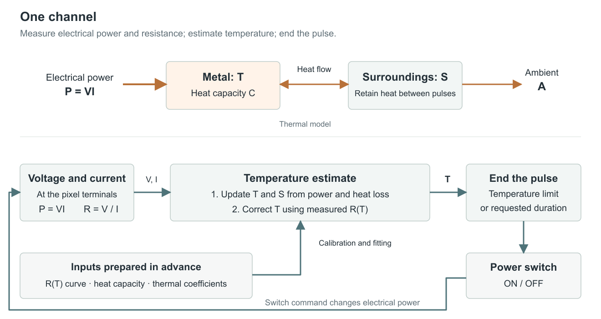

# Temperature-limited heating pulses

**Rev08 · Single-channel model and implementation**

## Summary

- **End each fixed-amplitude heating pulse at an estimated temperature ceiling or its requested duration.** This controls pulse termination; tactile displacement and force remain separate quantities to measure.
- **Predict two temperatures: metal and surrounding material.** Electrical power heats the metal, while the surroundings retain heat between pulses. Three fitted heat-transfer coefficients describe this exchange.
- **Correct the predicted metal temperature using measured resistance and the calibrated resistance–temperature curve.** The model carries the heating and cooling history; resistance supplies a new observation. A short table search balances their agreement.
- **Handle a resistance value that corresponds to two temperatures.** Search near the predicted temperature and stop when two distinct compatible branches remain. Where resistance changes little with temperature, the model supplies most of the estimate.
- **Use a measured stopping allowance and a local timer.** The allowance covers observed underestimation; the timer accounts for further heating and switch delay. Fit on one experiment and check fixed settings on another. The result is an effective-temperature estimate checked under the intended operating conditions.

## 1. One heater and its inputs

Voltage and current reveal both the electrical heat entering the metal and its resistance. Combining these readings with the heating history tells the controller when to end the pulse.



The adjustable supply powers one resistive heater through a switch. Separate voltage-sense connections measure across the active metal; current measurement includes any sensing-network current that bypasses the current sensor. The controller receives corrected, time-aligned voltage $`V`$ and current $`I`$.

| Symbol | Meaning |
|---|---|
| $`T,S,A`$ | Effective metal, surroundings and ambient temperatures, °C |
| $`t,\Delta t`$ | Time and elapsed update interval, s |
| $`P`$ | Interval-average heater-power input used by the model, W |
| $`C(T)`$ | Active-metal heat capacity, J/K |
| $`G`$ | Metal-to-surroundings thermal conductance, W/K |
| $`\beta`$ | Rate at which the surroundings warm in response to $`T-S`$, s⁻¹ |
| $`\gamma`$ | Rate at which the surroundings cool toward ambient, s⁻¹ |
| $`R_0,q(T)`$ | Metal resistance at ambient, Ω, and dimensionless curve $`R(T)/R_0`$ |
| $`V,I`$ | Corrected heater-terminal voltage, V, and heater current, A |
| $`e_R`$ | Normalized-resistance error allowance, dimensionless |
| $`w`$ | Permitted temperature-correction width, K |
| $`T_c,M`$ | Selected temperature ceiling, °C, and empirical stopping allowance, K |

The software interface is:

```pseudocode
UPDATE(t, T, S, average_power, V, I, settled_reading, heating)
    returns updated T, S, measurement_status and switch_off_deadline
```

Load the electrical calibration, resistance curve, heat capacity and fitted coefficients before operation. Calculate $`C(T)=m c_p(T)`$ from active-metal mass $`m`$ and alloy specific heat $`c_p`$. Pixels from the same stock can share the material curve; each needs its own ambient resistance $`R_0`$.

## 2. Predict heating and retained heat

Predicting heating between resistance readings lets the controller respond before another measurement arrives and account for heat left by earlier pulses.

Use

```math
C(T)\frac{dT}{dt}=P-G(T-S),\qquad
\frac{dS}{dt}=\beta(T-S)-\gamma(S-A).
```

The first equation subtracts heat leaving the metal from electrical heat entering it. Dividing that net power by heat capacity gives the temperature change per second.

- **Heat capacity** is the energy required to raise the metal temperature by one degree. A larger capacity gives a slower rise for the same power.
- **Heat transfer** $`G(T-S)`$ grows with the temperature difference. It removes heat when the metal is hotter and returns heat when the surroundings are hotter.
- **Retained heat** is represented by $`S`$. The second equation adds warming from the metal and subtracts cooling toward ambient. Keeping this state during pauses explains why identical pulses can reach different temperatures.

Multiplying these rates by the elapsed time gives the prediction for one short interval:

```math
T_{\rm pred}=T+\Delta t\frac{P-G(T-S)}{C(T)},\qquad
S_{\rm pred}=S+\Delta t[\beta(T-S)-\gamma(S-A)].
```

Use the old $`T,S`$ on both right-hand sides. Divide longer intervals into steps no greater than one tenth of the smaller time scale $`C_{\min}/G`$ and $`1/(\beta+\gamma)`$, where $`C_{\min}`$ is the minimum heat capacity over the operating range. This is a practical integration setting; halve it during the offline replay and check that the change is small compared with the selected temperature resolution.

Calculate the power input in the same way during fitting and operation:

1. **Settled heating:** average two consecutive measured powers from the same continuous ON interval, $`P=(V_{\rm old}I_{\rm old}+VI)/2`$.
2. **Switching and analog settling:** use $`P=P_{\max}`$ during the measured settling interval. Calculate $`P_{\max}=V_{\max}^2/R_{\min}`$, with the largest checked terminal voltage, including excursions, and the smallest calibrated metal resistance.
3. **OFF time:** use the measured residual power.
4. Split an update at each switch transition or settling boundary; apply the corresponding power to each part.

Initialize $`T=S=A`$ after the measured cooling period. Continue updating both temperatures during every pause.

## 3. Convert the resistance curve into a correction

Resistance adds temperature information to the power-based prediction, helping correct accumulated error before the controller decides whether heating can continue.

Normalize a stock curve at the operating ambient: $`q(T)=q_{\rm cal}(T)/q_{\rm cal}(A)`$. Then $`q(A)=1`$ matches the current pixel's measured $`R_0`$. Include this scaling and ambient/reference-resistance uncertainty in the error allowance. Order the resulting pairs $`(T_j,q_j)`$ by temperature and interpolate:

```math
q(U)=q_j+\frac{q_{j+1}-q_j}{T_{j+1}-T_j}(U-T_j),
```

where $`U`$ is a candidate temperature. This draws a straight line between neighboring measured points. Place points around each turning region so the lines capture the change in direction; remaining interpolation error belongs in $`e_R`$.

Dividing voltage by current gives resistance; dividing again by its ambient value makes it comparable with the normalized calibration curve:

```math
y=\frac{V}{I R_0}.
```

Prepare a table of $`q(U)`$ at **1 °C spacing**, using the interpolation above. Also calculate $`L`$, the largest absolute interpolation slope. For each table temperature within $`T_{\rm pred}\pm w`$, test

```math
|y-q(U)|\le e,\qquad e=e_R+L\,(1\ ^\circ\mathrm C).
```

The second term allows for the grid and a window boundary between grid points. The 1 °C spacing is a numerical resolution, not a measurement accuracy. Require $`w\ge1`$ K. Neighboring passing temperatures form a connected group, called a run in the pseudocode. No run means disagreement between the electrical reading and the allowed correction. More than one separated run means that distinct local resistance branches remain. Either result ends the heating pulse.

When one run remains, score each temperature for two kinds of disagreement: its distance from the prediction and the difference between its expected resistance and the measurement. Choose the lowest score:

```math
J(U)=\left(\frac{U-T_{\rm pred}}{w}\right)^2+
\left(\frac{y-q(U)}{e_R}\right)^2.
```

Also evaluate $`J`$ at the continuous prediction $`T_{\rm pred}`$ itself, using interpolated resistance, if it passes the same resistance test. Select the lower-cost candidate; choose the continuous prediction on a tie. This preserves temperature changes smaller than a grid step. Set $`T`$ to the selected temperature and $`S=S_{\rm pred}`$. Dividing by $`w`$ and $`e_R`$ puts the two disagreements on comparable scales. A flat $`q`$ gives nearly equal resistance scores, so the prediction dominates. A steep slope makes resistance more informative. The initialized thermal history selects the search region; resistance distinguishes temperatures within it.

**Set two fixed correction settings:**

1. **Resistance allowance $`e_R`$:** add the checked electrical-error allowance and the curve-error allowance, both expressed as fractions of $`R_0`$. Include reference uncertainty, observed heating–cooling variation and the stated interpolation allowance. Store a positive value.
2. **Search width $`w`$:** compare the uncorrected model with aligned independent temperature readings on the fitting experiment. Take the largest absolute temperature difference, add reference uncertainty and 1 K, and use at least 1 K. Keep this width fixed for validation.

When independent temperature readings are unavailable, $`w`$ is a declared engineering setting. Section 5 states the operating claim supported by that case.

**Illustrative curve.** Suppose measured anchors were $`(20,1.000),(400,1.040),(600,1.060),(800,1.040)`$. These values illustrate the calculation and are not a NiCr calibration. A reading $`y=1.050`$ has solutions near 500 and 700 °C. With $`T_{\rm pred}=510`$ °C and $`w=20`$ K, only the neighborhood of 500 °C is searched. With a prediction of 600 °C and a 120 K search window, both branches remain and heating stops.

## 4. End a heating pulse

The controller converts its current temperature estimate into a future switch-off time, allowing heating to end before the next measurement arrives.

The requested pulse specifies fixed voltage, maximum duration and $`T_c`$. Set the stopping allowance $`M`$ from the completed observer on the fitting experiment:

1. At each aligned reference reading, subtract the corrected estimate from the independently measured temperature.
2. Keep the largest positive difference, or zero if all differences are negative.
3. Add the temperature-reference uncertainty and 1 K for the numerical grid.
4. Check this fixed allowance on the separate validation experiment.

At state time $`t`$, calculate

```math
t_{\rm temperature}=t+
\frac{[T_c-M-\max(T,S)]C_{\min}}{P_{\max}}-\tau_{\rm off},
```

where $`P_{\max}`$ bounds delivered heater power, including switching excursions, and $`\tau_{\rm off}`$ is the measured timer/physical-turn-off delay. Set the local timer to the earliest of this deadline, the original requested pulse end, and the last valid reading plus the permitted data age minus $`\tau_{\rm off}`$. Turn off immediately if that time has passed.

The rule reserves the checked allowance $`M`$ before calculating how much additional temperature rise is available. It uses the hotter state because warm surroundings can return heat to the metal. The modeled maximum heating rate, $`P_{\max}/C_{\min}`$, converts that remaining rise into time. Subtracting the turn-off delay makes the command occur early enough for the switch to respond.

**One clock cycle.** Take illustrative values $`T=500`$, $`S=100`$, $`A=20`$ °C; $`C=0.001`$ J/K, $`G=0.001`$ W/K, $`\beta=1`$, $`\gamma=0.2`$ s⁻¹; $`P=10.4`$ W and $`\Delta t=0.001`$ s. The prediction is $`T_{\rm pred}=510`$, $`S_{\rm pred}=100.384`$ °C. With the illustrative curve, $`y=1.050`$, $`w=20`$ K and $`e_R=0.001`$, the grid minimum is **502 °C**: its prediction and resistance contributions to $`J`$ are 0.16 and 0.04.

For $`T_c=550`$ °C, $`M=15`$ K, $`P_{\max}=12`$ W, $`C_{\min}=0.001`$ J/K and $`\tau_{\rm off}=50`$ µs, the temperature deadline is **2.70 ms after this state time**. A shorter requested duration or earlier data expiry takes precedence.

## 5. Fit once, then validate separately

Fitting makes the thermal model follow the measured heater; a separate validation sequence tests whether that model and its stopping allowance end useful pulses at the selected limit.

The fitting experiment identifies $`G,\beta,\gamma`$. Choose a checked pulse width $`t_p`$ and onset interval $`t_r>t_p`$; keep the voltage fixed. Log gate transitions, voltage, current and ambient temperature throughout:

1. From ambient, apply one pulse of width $`t_p`$; wait $`4t_r`$ after turn-off.
2. Apply four pulses, with starts separated by $`t_r`$.
3. Wait $`t_r`$ after the last turn-off; apply one pulse.
4. Wait $`4t_r`$ after turn-off; apply one final pulse.

The isolated pulse identifies rapid heating. The train and restart pulses reveal heat retained between pulses.

For each positive candidate $`G,\beta,\gamma`$, replay the complete record from ambient using the power-input recipe and prediction equations. **Do not apply resistance corrections during this replay:** they would hide prediction errors that the fitted coefficients must explain. Minimize

```math
J_{\rm fit}=\sum_{k\in\text{settled readings}}
\left[\frac{q(T(t_k))-V_k/(I_kR_0)}{e_R}\right]^2.
```

Fix heat capacity from geometry and material data; fit the three heat-transfer coefficients using Appendix B. Independent temperature observations distinguish fits with similar resistance predictions but different temperature histories.

For foil, a pyrometer can provide these observations when its spot lies on the active metal, emissivity is calibrated, and its temporal response resolves the experiment. Begin with sufficiently slow pulses for that instrument. For ultrafine wire, the same-stock equilibrium calibration establishes the material curve; it does not supply in-pulse temperature observations.

The validation experiment checks the completed controller with fixed coefficients, $`e_R,w,M`$, voltage and load range:

1. From the same initial ambient condition, apply four pulses with alternating widths $`t_p/2,t_p,t_p/2,t_p`$, starting every $`t_r`$.
2. Wait $`2t_r`$ after the final turn-off, then apply one pulse of width $`t_p`$.
3. Use full-duration pulses throughout if a half pulse supplies no settled reading.

Evaluate four outcomes:

1. Predicted and measured resistance agree without refitting.
2. Independent temperature, where resolved, stays within the stated stopping allowance and below the ceiling after turn-off.
3. The observer remains on a coherent branch and permits useful displacement or force.
4. Pulse termination and retained heating behave correctly under the intended mechanical load.

Agreement in resistance tests electrical prediction, including across a nonmonotonic curve. Without resolved independent temperature data, use the observer as experimental estimate-based pulse control within the previously checked finite-pulse protocol; $`M`$ remains a declared engineering margin. A demonstrated temperature-error allowance requires the independent reference. Restrict operation to the checked pulse, load and repetition range. The inferred $`T`$ is a resistance-related effective metal temperature; a small hotspot can be hotter than this estimate.

## Appendix A. Clock-cycle arithmetic

This update combines predicted heating, resistance correction and the switch-off deadline into the calculation that ends each pulse.

The table contains candidate temperature `U` and interpolated `q`. A settled reading is invalid if it times out, saturates, or has current below the calibrated measurement range. `permitted_data_age` is the configured maximum delay between valid readings. Time `t` is the update endpoint; `state_time` is the previously represented time. Split intervals at switching events. The electrical routine supplies interval-average `P` and a valid settled reading flag.

A ±20 K search on a 1 °C grid checks at most 41 entries plus the continuous prediction: a few hundred arithmetic operations for one thermal substep. Calculate the first and last grid indices from `predicted ± w`. Precompute `1/w²` and `1/eR²` once to evaluate the same score with multiplications. A 20–800 °C table contains 781 float32 resistance values, occupying 3,124 bytes.

```pseudocode
UPDATE(t, T, S, P, V, I, settled, heating):
    if t <= state_time: switch OFF; return timestamp_fault
    if heating and settled and readings_invalid: switch OFF; return measurement_fault
    remaining = t-state_time
    hmax = 0.1*min(Cmin/G, 1/(beta+gamma))
    while remaining > 0:
        h = min(remaining,hmax)
        Tnew = T + h*(P-G*(T-S))/C(T)
        Snew = S + h*(beta*(T-S)-gamma*(S-A))
        T = Tnew; S = Snew; remaining = remaining-h; state_time = state_time+h
        if T is outside calibration: switch OFF; return range_fault
    state_time = t
    if not heating: return T, S
    if settled:
        y = V/(I*R0)
        predicted = T; best_cost = infinity; runs = 0; previous_pass = false
        for consecutive grid entries with abs(U-predicted) <= w:
            passes = abs(y-q) <= eR + L*grid_step
            if passes and not previous_pass: runs = runs+1
            if passes:
                cost = ((U-predicted)/w)^2 + ((y-q)/eR)^2
                if cost < best_cost: best_cost = cost; best_T = U
            previous_pass = passes
        if runs != 1: switch OFF; return mismatch_or_ambiguity
        q_pred = interpolate_q(predicted)
        if abs(y-q_pred) <= eR + L*grid_step:
            cost = ((y-q_pred)/eR)^2
            if cost <= best_cost: best_T = predicted
        T = best_T; last_valid_time = t
    temperature_end = t + (Tc-M-max(T,S))*Cmin/Pmax - turn_off_delay
    data_end = last_valid_time + permitted_data_age - turn_off_delay
    deadline = min(original_pulse_end,temperature_end,data_end)
    if deadline <= now: switch OFF
    else: arm local switch-off timer for deadline
    return T, S, deadline
```

A fault preserves the last computed state and disables subsequent pulses. Before starting a pulse, update OFF cooling to its start time, set `last_valid_time` to that time, and fix `original_pulse_end = start_time + requested_duration`. Calculate the same deadline above. In one short uninterrupted operation, check that the deadline is future, arm the timer and enable the switch; otherwise leave it OFF. Record the actual gate transition. The data-expiry term supplies the first-reading deadline. After reset, complete the established cooldown before initializing to ambient.

## Appendix B. Reproducible coefficient search

Adjusting the three heat-transfer coefficients makes the model reproduce measured heating and cooling, reducing the correction required during operation.

Use reference values $`G=C(A)/t_p`$, $`\beta=1/t_r`$, $`\gamma=1/(4t_r)`$. Try exactly three starts, multiplying all three reference values together by 0.1, 1 or 10. This is a small local search; independent temperature checks distinguish physically different fits.

```pseudocode
COST(G, beta, gamma):
    set T=A, S=A, cost=0
    replay every logged power interval using the prediction equations
    at each valid resistance sample:
        cost = cost + ((q(T)-V/(I*R0))/eR)^2
    return cost, or infinity if temperature leaves calibration

FIT():
    for common starting factor 0.1, 1 and 10:
        coefficients = starting_factor * reference_coefficients
        ratio = 2
        for at most 200 search rounds:
            evaluate current coefficients and six alternatives:
                multiply or divide one coefficient by ratio
            if an alternative lowers COST: retain the best alternative
            else: ratio = sqrt(ratio)
            if ratio < 1.02: finish this start
        if search completed and cost is finite: retain fit and predicted temperatures
    if no finite completed fit remains: return fitting_failure
    return the lowest-cost completed fit and the other completed fits
```

Inspect systematic residuals and alternative temperature histories. Unfinished searches or incompatible independent temperatures require resolving that specific fit before operation. The validation record remains separate from fitting and allowance selection.

## Appendix C. Processor implementation

Keeping measurement and switch-off timing on the local processor allows each pulse to finish from its temperature estimate while the PC handles setup and records.

This is a reasonable single-channel workload for the 600 MHz Teensy 4.1 with hardware floating point; verify complete measurement, update and timer duration on the assembled board. The macro circuit measures current and both terminal voltages; the wire channel measures shunt current and selected differential voltage. Apply each circuit's measured bypass-current correction before forming $`VI`$ or $`V/I`$. USB transfers configuration and buffered records outside the pulse-control calculation.
