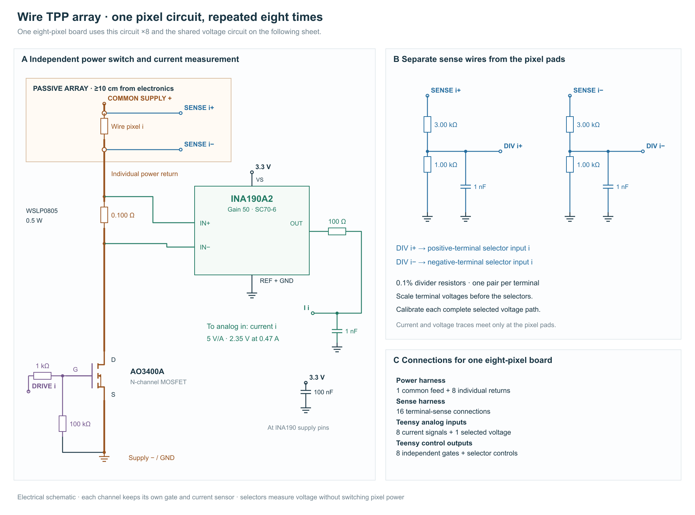

# Wire array: circuit and calibration

- **Repeat one independently controlled heater channel eight times per board.** Four identical boards serve 32 pixels. Every pixel has its own MOSFET, shunt and current amplifier.
- **Share voltage measurement within each board.** Two selectors connect the chosen pixel’s terminal-sense wires to one difference amplifier. The other pixels can continue heating during that measurement.
- **Keep the tactile array passive.** Place sensing and switching electronics in the housing, at least 10 cm from the pixels; run separate power and voltage-sense conductors to the heater pads.
- **Use the same temperature-estimation calculation for every pixel.** Each channel supplies measured voltage/current and its own room-temperature resistance. Pixels from one wire batch share the calibrated material curve.
- **Complete one eight-channel board first.** Its concurrent-load measurements establish supply droop, sensing error and delay to switch-off before the design is duplicated.




## 1. Build the repeated channel

A separate switch and current measurement let each pixel heat and stop independently, even while other pixels remain active.

1. Connect supply positive → heater → **0.100 Ω shunt → AO3400A → supply negative**. Place the shunt and switch on the electronics board.
2. Run two short, separate traces from the shunt pads to INA190A2 inputs. Its gain of 50 gives a nominal current sensitivity of **5 V/A**.
3. Connect each heater terminal to a 3 kΩ/1 kΩ divider. Connect the divider midpoints through the TMUX1108 pair to the shared AD8276, as shown above.

At 0.47 A, the current output is approximately **2.35 V** and the shunt dissipates **22 mW**. Set the initial total heater-current ceiling to **0.55 A**, including sensing-network current that bypasses the shunt.

The selectors choose both terminals of the same pixel; the AD8276 subtracts them. The rail remains below 10 V and the analog circuitry uses 3.3 V.

For each group of eight pixels, provide **25 functional conductors:** one common positive feed, eight individual returns and sixteen voltage-sense connections. Begin the sense connections at the heater pads. Rate the common feed and connector for at least the intended 4.4 A eight-channel ceiling.

## 2. Supply concurrent pulses

Concurrent pulses draw their combined current from the supply; this check preserves the intended heating rate when several pixels turn on together.

A 12.5 Ω heater at 2.8 W requires

```math
I=\sqrt{2.8/12.5}\approx0.47\ {\rm A},\qquad V=IR\approx5.9\ {\rm V}.
```

Eight such heaters use approximately **3.8 A**; 32 use approximately **15 A and 90 W of instantaneous heater power**. At 20% duty, mean heater power is approximately 18 W. The supply and conductors must support the concurrent current even when average power is much lower.

1. Connect eight stable 12–13 Ω resistor loads rated for the calibration power.
2. Increase the rail while measuring voltage at each load’s sense terminals. Record rail voltage, heater voltage and current with one, several and all eight loads on.
3. Select a rail setting that supplies the intended heater voltage without exceeding any channel’s current ceiling.
4. Repeat with the intended pulse pattern. Record the minimum/maximum rail voltage and the largest measurement error after simultaneous switching.
5. Use those extrema in the controller configuration. A pulse request exceeding the checked concurrent-load condition must reduce concurrency or drive amplitude.

## 3. Calibrate current and voltage

Temperature estimation needs the wire’s resistance, so calibration removes sensing errors and the separate sense leads exclude cable and switch losses.

1. For each channel, measure two positive reference currents with the ammeter in the **shunt/MOSFET branch**. Record ADC codes $`n_1,n_2`$ and reference currents $`x_1,x_2`$.
2. Calculate $`a=(x_2-x_1)/(n_2-n_1)`$, $`b_0=x_1-an_1`$; convert subsequent codes using $`x=an+b_0`$. Check a third current and repeat after warming the board.
3. Apply two measured differential voltages through the actual sense connections and selected front end. Calculate voltage gain and offset with the same formula. Check a third value, the installed terminal common-mode voltage, and changes caused by neighboring channels.

The heater current is

```math
I=I_s+b,\qquad R=V/I,\qquad P=VI.
```

Here $`b`$ is **signed net sensing-network current bypassing the shunt**. The bare negative-terminal divider contributes approximately $`V_-/4000`$; loading by the connected difference amplifier can change its magnitude and sign.

1. Measure total current in the **heater lead before the sensing branch**.
2. Subtract the calibrated shunt-branch current to obtain $`b`$.
3. Repeat with each selector position, intended neighboring loads and a warm board.
4. Store a correction and an error range covering those readings and reference-meter uncertainty. If the difference is below the meter’s resolution, include that resolution in the error range.
5. Measure off-current in the heater lead and store its upper bound.

Pulse the resistor loads using the final cable and scan order. Record selection-to-settled-reading time, relative voltage/current delay, and measurement-to-current-off delay. Use only settled conducting readings for $`V/I`$.

## 4. Apply the single-channel controller

Every pixel retains its own temperature history, so an earlier pulse shortens its remaining heating allowance without changing other pixels’ commands.

Use Temperature control separately for each channel. Store each pixel’s electrical calibration and resistance $`R_0`$ at ambient temperature $`A`$; load the same-batch curve from the wire-temperature fixture, rescaled so $`q(A)=1`$. Each channel retains its own heater temperature $`T`$ and surroundings temperature $`S`$.

For each active channel:

1. Select its two voltage terminals and wait the measured settling time.
2. Read its current and selected voltage; align their timestamps and calculate corrected $`I,V,R,P`$.
3. Predict that channel’s $`T,S`$, then score the 1 °C temperature-table entries against the prediction and measured $`R/R_0`$. Stop on mismatch or separated compatible groups. For one group, select the lowest-cost candidate, also scoring the continuous prediction to preserve changes smaller than a grid step.
4. End its fixed-amplitude pulse when $`\max(T,S)+M`$ reaches the requested temperature ceiling. Update its timer deadline for the remaining temperature allowance, maximum duration and measurement expiry.
5. Retain its thermal state after switch-off. Record channel, timestamp, measurements and stopping reason.

The board timer serves the earliest active deadline. A measurement fault stops the affected operation and blocks further requests until corrected. The PC sends settings and finite sequences; local timing remains independent of PC communication. Until a resolved independent temperature reference checks $`M`$, it is an engineering stopping allowance rather than a measured temperature-error limit.

## 5. Check the assembled pixels

Pixel assembly, neighboring heaters and mechanical contact change heat loss; the operating checks establish where the fitted model produces repeatable tactile output.

1. Check array continuity and connector orientation before installing the wire. Keep the common heater feed isolated from any conflicting ground connection.
2. Record each assembled pixel’s ambient resistance. Compare it with its wire length and with other pixels of the same geometry; inspect unusually large differences.
3. Run the fitting sequence on a representative pixel. Give **every finished pixel** the separate fixed-model operating check; refit only pixels for which that check fails.
4. Repeat the operating check with intended neighboring-pixel activity and mechanical contact.
5. Measure displacement or force as well as resistance. Record the pulse amplitude, repetition rate and load condition associated with repeatable useful output. Resistance residuals test electrical/model consistency; a temperature-error claim additionally requires an independent temperature reference that resolves the transient.

## Appendix A. Parts

Each pixel gets its own current and switch components; eight pixels share the voltage-measurement components.

| Per pixel | Selection |
|---|---|
| Current amplifier | INA190A2DCKR, SC70-6; 3.3 V; REF grounded |
| Shunt | Vishay WSLP0805R1000FEA, 0.100 Ω, 1%, 0.5 W |
| Switch | AO3400A |
| Gate components | 1 kΩ series; 100 kΩ gate-to-source |
| Terminal dividers | Two 3.00 kΩ/1.00 kΩ pairs, 0.1%, low temperature coefficient |
| Filters | 1 nF per divider; current output 100 Ω/1 nF |
| Supply bypass | 100 nF at current amplifier |

| Per eight-channel board | Quantity |
|---|---:|
| Teensy 4.1 | 1 |
| Pixel circuits above | 8 |
| TMUX1108PWR | 2 |
| AD8276BRZ | 1 |
| Shared-voltage output filter | 100 Ω/100 pF |
| Shared-IC supply bypasses | Three 100 nF capacitors |
| Shared selector-enable pull-down | 10 kΩ |

Provide a physical supply disconnect, supply protection and connectors rated for concurrent current. Place shunts/amplifiers away from switch heating; route power current separately from measurement ground.

## Appendix B. Connections

The following connections select one pixel’s voltage while leaving all eight power switches independently controlled.

**INA190A2 DCK:** pin 1 REF, 2 GND, 3 VS, 4 IN+, 5 IN−, 6 OUT.

Both TMUX1108 selectors use 3.3 V, common address/enable lines, and grounded VSS/GND. Enable HIGH connects the selected inputs; LOW disconnects them.

**AD8276BRZ:** selected positive divider to pin 3; negative divider to pin 2; pin 7 to 3.3 V; pin 4 and REF pin 1 to ground; SENSE pin 5 to OUT pin 6. OUT feeds 100 Ω with 100 pF at the ADC. Check the selected voltage path over approximately 0.20–2.50 V output and its recovery from zero-output saturation.

| Function | Teensy pins |
|---|---|
| Eight current outputs, ADC0 | 14–21 |
| Selected differential voltage, ADC1 | 26 |
| Eight heater gates | 2–9 |
| Selector A0/A1/A2 | 10/11/12 |
| Selector enable | 13 |
| Common start / external stop | Reserve 0/1 with defined default levels |
