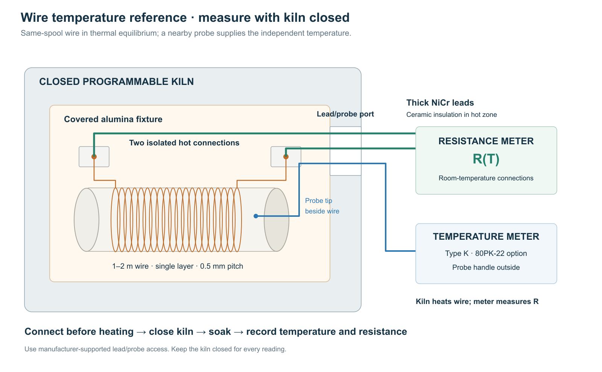

# Wire-temperature reference

- **Measure same-stock spare wire at known temperatures.** The resulting resistance–temperature curve supplies the material reference used by the active pixel’s controller.
- **Heat the specimen in a closed kiln.** An adjacent probe measures temperature while a bench meter measures resistance through permanently connected leads.
- **Use a long specimen.** A 1–2 m winding of approximately 31 µm NiCr has about 1.4–2.9 kΩ resistance; thick leads then add a small, measurable correction.
- **Keep the nonmonotonic shape.** Place references around each turning point and repeat selected points during cooling.
- **Keep material and actuator measurements separate.** Each finished pixel also needs its own ambient resistance and operating check.



## 1. Assemble the reference specimen

Heating the entire winding to nearly one temperature lets the adjacent probe assign a temperature to its total measured resistance.

1. Wind **1–2 m of same-stock wire** in one noncrossing layer around a **20 mm outside-diameter alumina tube**. At 0.5 mm pitch, 16–32 turns occupy 8–16 mm. Leave expansion slack and support the ends separately.
2. Put the winding in a loosely covered alumina boat near the kiln center; place the reference probe beside it.
3. Connect two approximately **0.5 mm NiCr leads** using isolated high-temperature compression contacts on ceramic. Separate the leads with ceramic bores or beads through the hot zone.
4. Install leads and probe through **manufacturer-supported access** before heating. Keep the kiln closed during every reading.

Select the kiln and supported feedthrough arrangement together. A vent opening alone does not establish that electrical leads can safely pass through it.

## 2. Check the electrical measurement

The long fine wire makes specimen resistance much larger than lead resistance; measuring the remaining lead contribution preserves small temperature-dependent changes.

Representative NiCr80 resistivity gives approximately **1440 Ω/m** for 31 µm wire. A total of 0.6 m of 0.5 mm NiCr leads adds approximately **3.3 Ω**. A 7% change in that lead resistance is 0.23 Ω, or **0.016%** of a one-metre specimen. Use measured lead resistance and the actual lead alloy’s thermal variation in the calculation.

1. Before attaching the fine wire, join the hot-end contacts and measure total lead/contact resistance at ambient.
2. Attach the specimen. Record resistance and check connection stability while gently moving the external leads.
3. Record the meter’s measuring current. At 100 µA, a 1440 Ω specimen dissipates approximately **14 µW**.
4. At one steady kiln temperature, repeat the reading with a second small measurement current. Resolve any reproducible resistance shift from self-heating or range error before continuing.
5. Save meter uncertainty, lead correction and connection variation separately.

A two-wire measurement is sufficient when these errors fit the required resolution. Locally, normalized-resistance uncertainty $`u_q`$ corresponds to $`u_T\approx u_q/|dq/dT|`$. At a resistance turning point, that local conversion fails; the controller uses the curve together with thermal history.

## 3. Collect the temperature references

A few equilibrium readings establish the temperature scale; additional points near turning regions preserve the nonmonotonic shape used by the observer.

1. At equilibrium, record calibration ambient $`A_{\rm cal}`$, total resistance and lead/contact correction.
2. At one steady elevated temperature, compare probe readings beside the winding’s center and ends. Include the spatial spread with probe uncertainty.
3. Step the kiln upward. Record a reference after temperature and resistance are stable within instrument repeatability.
4. Begin with approximately five references: ambient, rising branch, observed extremum, falling branch and upper calibration temperature. For an 800 °C reference, kiln, probe, insulation and contacts must all cover that temperature.
5. Add a point wherever another turning region or interpolation uncertainty remains unresolved.
6. Repeat selected references on cooling, then measure final ambient resistance. Keep any baseline drift with the record.

Equilibrium and a sufficiently uniform enclosure connect the adjacent probe reading to the winding temperature. Opening the door would replace that reference condition with an unknown cooling transient.

## 4. Prepare the controller table

Dividing by ambient resistance removes specimen length from the curve, allowing a long calibration winding to describe a short pixel made from the same stock.

For each reference calculate

```math
q_{\rm cal}(T)=\frac{R_{\rm meas}(T)-R_{\rm leads}(T)}
{R_{\rm meas}(A_{\rm cal})-R_{\rm leads}(A_{\rm cal})}.
```

1. Save temperature, measured resistance, lead correction, corrected resistance and $`q_{\rm cal}(T)`$.
2. Add probe/spatial, meter, residual lead/contact and heating–cooling uncertainties.
3. Sort by temperature and connect adjacent points with straight lines, retaining every observed extremum. Export the curve for the 1 °C lookup table in Temperature control.
4. Measure each finished pixel’s $`R_0`$ at operating ambient $`A`$. Rescale the curve with $`q(T)=q_{\rm cal}(T)/q_{\rm cal}(A)`$, so $`q(A)=1`$; use $`R(T)=R_0q(T)`$. $`A`$ must lie within the calibrated range. Store the wire-stock identifier.

This experiment establishes the equilibrium material curve. Pulse-response measurements test the assembled actuator’s thermal model; resistance agreement alone does not independently measure transient temperature error.

## Appendix A. Equipment

The enclosure, probe and insulated connections must cover the same upper temperature so the reference remains meaningful throughout the measurement.

| Item | Configuration |
|---|---|
| Kiln | Programmable through the upper reference; supported lead/probe access |
| Specimen and support | Same-stock wire; alumina tube and covered boat |
| Leads and contacts | Thick NiCr, ceramic insulation, isolated high-temperature compression contacts |
| Temperature instrument | Probe/thermometer with documented uncertainty over the reference range |
| Resistance instrument | Bench meter with documented accuracy and measuring current |
