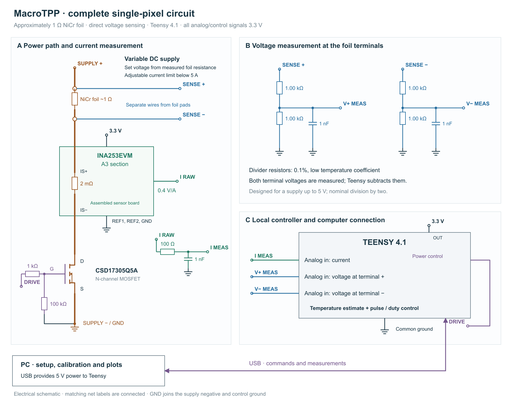

# Foil pixel: circuit and calibration

- **This circuit drives one centimetre-scale thermopneumatic pixel.** Electrical pulses heat its foil; the resulting gas expansion moves the membrane. The controller regulates estimated foil temperature, while a separate displacement or force measurement checks tactile output.
- **Voltage and current provide two useful measurements:** resistance $`R=V/I`$, which changes with temperature, and power $`P=VI`$, which drives the thermal model.
- **The temperature estimate combines both.** A model predicts heating and cooling; a calibrated table identifies temperatures consistent with the measured resistance. The controller selects the temperature that best matches both. A second temperature records heat retained around the foil.
- **Calibration supplies the missing physical scale.** Pyrometer measurements establish resistance versus temperature. A pulse sequence identifies heat-transfer coefficients; a different sequence checks the result.
- **The selected hardware is one Teensy 4.1, INA253EVM A3 and CSD17305Q5A.** The PC prepares calibration and plots results; measurement and pulse termination run locally.



## 1. Connect power and measurement paths

Separate voltage-sense leads exclude cable and switch losses, so measured electrical power corresponds to heat delivered to the foil.

1. Connect supply positive → foil → INA253 current path → MOSFET → supply negative.
2. Attach two heavier power wires and **two separate sense wires at the foil pads**. Connect each sense wire to a 1 kΩ/1 kΩ divider.
3. Power Teensy through USB and the current sensor from its 3.3 V regulator. Route heater current back to the supply separately from measurement-ground traces.

Teensy’s inputs and outputs use **3.3 V**. The dividers reduce a 5 V terminal potential to approximately 2.5 V. Subtracting the two calibrated terminal potentials gives foil voltage without the cable, sensor or switch drops.

For approximately 1 Ω foil, 2, 3 and 4 V **across the foil** produce 4, 9 and 16 W. Use an adjustable **0–5 V supply with current limited below 5 A**. Begin calibration at low voltage and raise it while watching measured foil current. Normal operating pulses should remain in constant-voltage operation.

## 2. Calibrate the electrical readings

Electrical calibration makes a resistance change attributable to the foil rather than sensor gain or offset.

Use the final electronics and cables. Initially replace the foil with a stable 1 Ω resistor whose continuous rating exceeds the calibration power $`I^2R`$.

1. **Voltage channels:** disconnect heater power. Apply two measured DC potentials to each sense input. For ADC codes $`n_1,n_2`$ and reference voltages $`x_1,x_2`$, calculate
   ```math
   a=(x_2-x_1)/(n_2-n_1),\qquad b=x_1-an_1.
   ```
   Convert subsequent codes with $`x=an+b`$. Check an intermediate voltage and the small negative-terminal voltage present during conduction.
2. **Current channel:** put a reference ammeter in the **INA253/MOSFET branch**. Apply two positive currents spanning operation and calculate its gain and offset with the same formula. Check an intermediate current and repeat after the board warms. Remove the ammeter afterward.
3. **Switched-load check:** pulse the resistor. Record the time after switching at which reconstructed resistance settles, the channel delays, and the delay from a gate-off command to current cessation. Save the largest observed voltage/current errors together with reference-meter uncertainty.
4. **Power check:** record supply-voltage extrema and $`(V_s-V)/I`$, where $`V_s`$ is supply voltage and $`V,I`$ refer to the foil. Measure residual off-current in a **foil power lead**, which includes divider leakage.

For each settled electrical reading:

1. Acquire current together with the positive-terminal voltage, then with the negative-terminal voltage, then with the positive-terminal voltage again.
2. Interpolate the two positive-terminal readings to the middle timestamp; use the current measured at that timestamp.
3. Calculate

```math
V=V_+-V_-,\qquad I=I_s+V_-/D,\qquad R=V/I,\qquad P=VI.
```

Here $`I_s`$ is calibrated sensor-branch current and $`D`$ is the negative divider’s measured total resistance, nominally **2000 Ω**. Its small current passes through the foil but bypasses the sensor. The positive-divider current does not pass through the foil.

## 3. Establish the temperature scale

The pyrometer gives the temperature scale that electrical readings alone cannot supply. Heat capacity supplies the second physical scale: how much electrical energy raises the foil temperature by one degree.

1. Measure active foil length, width and thickness; calculate mass $`m=\rho lwd`$ using alloy density $`\rho`$.
2. Store heat capacity $`C(T)=m c_p(T)`$, where $`c_p(T)`$ is alloy specific heat. Keep uncertainty in dimensions and material data with this table.

Measure the resistance–temperature curve:

1. Record calibration ambient temperature $`A_{\rm cal}`$ and foil resistance $`R_{\rm cal}`$ after equilibration.
2. Hold the switch on at a low DC voltage. Once both electrical readings and pyrometer temperature remain stable within instrument repeatability, record $`V,I,T`$.
3. Raise voltage in steps. Include points on both sides of each resistance turning point and at the highest intended calibration temperature. Repeat selected points during cooling.
4. At each reference, check the center and ends of the active resistance-bearing region. The pyrometer spot must fit entirely on foil; apply its emissivity and reflected-radiation corrections.
5. Calculate $`q_{\rm cal}(T)=V/(IR_{\rm cal})`$. Store the measured points, a piecewise-linear curve and electrical/temperature uncertainty.

At operating ambient $`A`$, measure $`R_0`$ and use $`q(T)=q_{\rm cal}(T)/q_{\rm cal}(A)`$, so $`q(A)=1`$. The operating ambient must lie within the calibrated range.

Only spatially consistent equilibrium points establish the material curve. If center and end temperatures differ beyond the calibration allowance, reduce the gradient or use a more uniform reference specimen. A total-resistance versus spot-temperature curve requires a separate interpretation and cannot replace the material calibration unchanged.

## 4. Fit, check and operate

Electrical power predicts how fast the foil heats; resistance checks that prediction; the surroundings state accounts for heat left by earlier pulses. The controller estimates foil temperature $`T`$ and surroundings temperature $`S`$, with three fitted coefficients for heat exchange and cooling toward ambient $`A`$. Use the explicit calculations in Temperature control.

1. Load electrical calibration, $`R_0`$, resistance and heat-capacity tables, fitted coefficients and pulse limits. Start after the established cooldown, with $`T=S=A`$.
2. Request a finite sequence of **fixed-amplitude pulses**, specifying temperature ceiling $`T_c`$, maximum duration and repetition interval.
3. At every settled reading, calculate $`V,I,R,P`$. Predict $`T,S`$ with the thermal model, then score the 1 °C table entries near predicted $`T`$ against measured $`R/R_0`$. Stop if no group or separated groups of compatible temperatures remain. For one group, select the lowest-cost candidate, also scoring the continuous prediction to preserve changes smaller than a grid step.
4. End heating when $`\max(T,S)+M`$ reaches $`T_c`$. Here $`M`$ is an experimentally checked temperature allowance. The local timer also enforces maximum duration, measurement expiry and the predicted rise before switch-off. Continue calculating cooling for both states between pulses.
5. Run the independent sequence without refitting. Compare temperature with a pyrometer trace where its response resolves the pulse; record resistance residuals and displacement or force separately. Resistance agreement checks electrical/model consistency; it does not establish temperature error.

After a processor reset, keep power disabled for the cooldown measured after the hottest permitted run. This establishes the initial thermal state for the next sequence.

## Appendix A. Components and pins

These connections implement the separate power, current and terminal-voltage paths in the circuit figure.

| Item | Selected configuration |
|---|---|
| Processor | Teensy 4.1; USB power |
| Current sensor | INA253EVM **A3** section; 3.3 V; REF1/REF2 grounded; nominal 0.4 V/A |
| Power switch | CSD17305Q5A on an assembled copper carrier; source to supply negative |
| Gate | Pin 2 → 1 kΩ → gate; 100 kΩ gate-to-source |
| Current output | Sensor → 100 Ω → pin 14/ADC0; 1 nF at ADC input to ground |
| Positive terminal | 1 kΩ/1 kΩ divider → pin 26/ADC1; 1 nF midpoint-to-ground |
| Negative terminal | Identical divider → pin 27/ADC1 |
| Divider resistors | 0.1%, low temperature coefficient |
| Sensor bypass | 100 nF at supply pins |
| Heater supply | Adjustable 0–5 V; current limit below 5 A |

The miniature MOSFET needs a soldered current/thermal pad and copper area. Assemble it on a carrier or PCB with accessible supply, foil and test terminals. Power the analog circuitry before enabling heater power.
