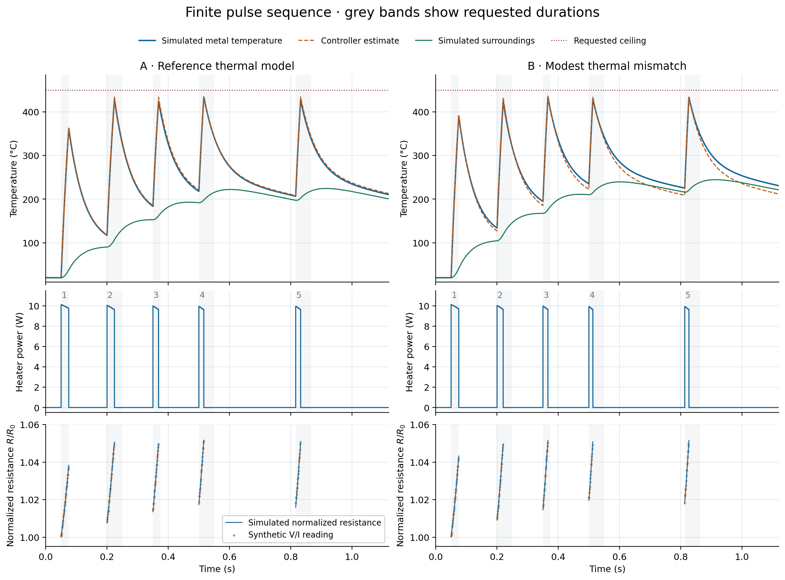
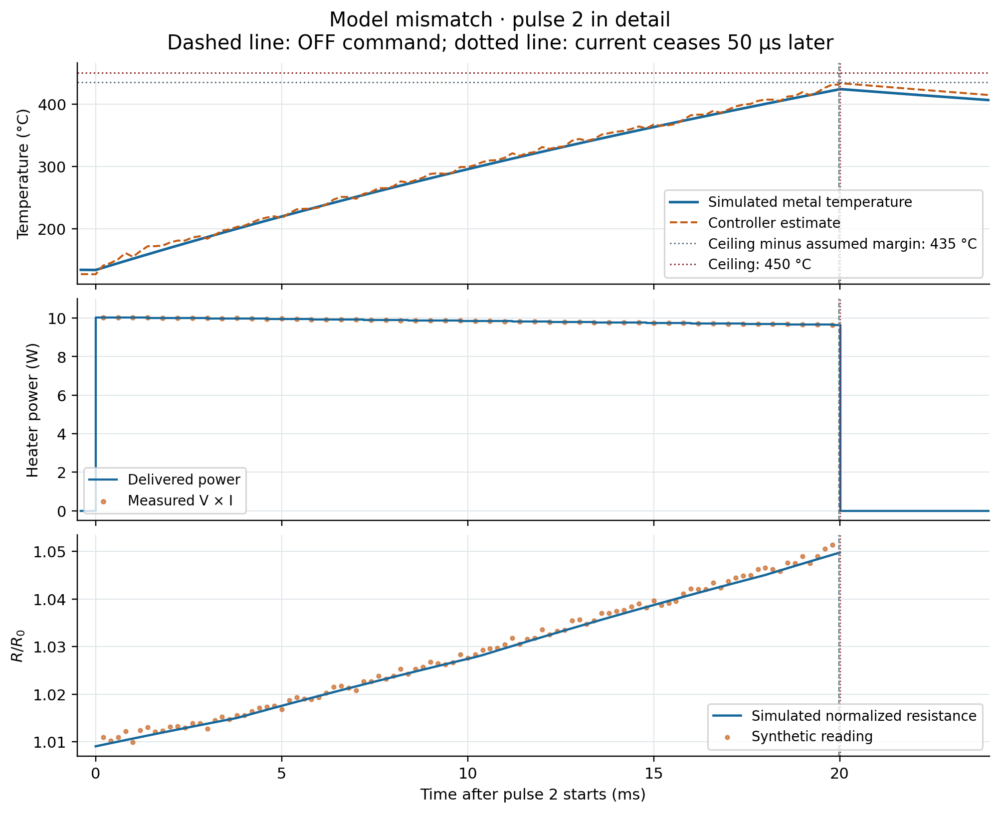
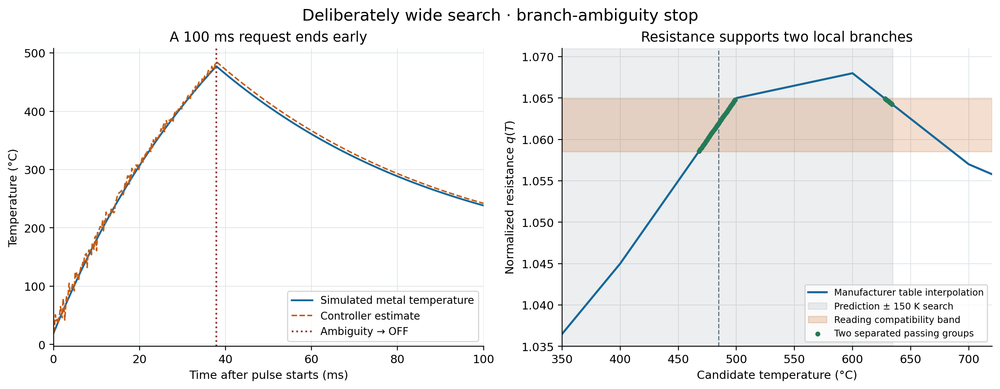

# Temperature-limited pulse examples

- **A finite pulse train demonstrates why retained heat matters.** The same voltage produces shorter pulses as the surroundings warm. The controller carries both temperatures through the pauses.
- **Two examples use the same requests and controller settings:** a reference thermal model and a modest mismatch in heat capacity and heat transfer. Their simulated peaks are 433.9 and 433.2 °C under a 450 °C ceiling.
- **The measurements include noise and bias.** Voltage and current each have 0.05% rms noise; their ratio has approximately 0.07% rms noise plus 0.05% bias. These are assumed calibrated measurement properties, not measured Teensy performance.
- **A separate ambiguity example ends a pulse early.** With a deliberately wider temperature search, the measured resistance supports two branches and heating stops.
- **These are reproducible numerical examples.** They demonstrate the controller's calculations and consequences under specified assumptions; they do not establish physical temperature accuracy or tactile output.

## 1. Physical example and controller settings

The simulation separates the heater’s temperature from the controller’s estimate, making their agreement and the resulting pulse termination directly visible. The heater and surroundings obey the two-temperature equations used in Temperature-limited heating pulses; their states are integrated separately from the controller calculation.

| Quantity | Assumed value |
|---|---|
| Active strip | 10 mm × 1 mm × 15 µm; **assumed geometry**, not a measured prototype |
| Metal mass and ambient resistance | 1.245 mg; 0.720 Ω |
| Heat capacity | Temperature dependent: 0.573 mJ/K at 20 °C; 0.784 mJ/K at 800 °C |
| Applied heater voltage | Fixed 2.70 V; approximately 3.75 A and 10.13 W initially |
| Nominal thermal coefficients | $`G=0.010`$ W/K, $`\beta=4`$ s⁻¹, $`\gamma=1`$ s⁻¹ |
| Temperature settings | Ceiling $`T_c=450`$ °C; assumed margin $`M=15`$ K; search half-width $`w=30`$ K |
| Resistance comparison | $`e_R=0.003`$, or 0.3% of ambient resistance; 1 °C table |
| Measurement timing | 0.20 ms updates; 0.10 ms startup settling; 1 ms maximum data age |
| Switch-off delay | Current continues for 0.050 ms after an OFF command |
| Power used by timer | $`P_{\max}=2.72^2/0.720=10.276`$ W; nominal $`C_{\min}=0.573`$ mJ/K |

The normalized resistance curve comes from **Alloy Wire International’s AWS180 NiCr80 datasheet, Rev.1**, including its maximum near 600 °C and decline toward 800 °C. Density and heat capacity come from Kanthal’s Nikrothal 80 data. These representative properties replace the laboratory stock’s measured values for this example. Full tables and source references are included in the downloadable package.

Both plant and controller use this same resistance curve. Thermal coefficients are selected, not fitted. The plant uses fourth-order Runge–Kutta integration with steps no longer than 10 µs; the controller uses the specified short Euler steps, table score, continuous-prediction candidate and local deadline. No resistance observation is supplied during OFF time.

The sensor model adds +0.03% voltage bias and −0.02% current bias, with independent Gaussian noise and a fixed random seed. It represents calibrated V/I readings rather than an ADC bit-level model. Complete settled ON intervals use endpoint $`VI`$ trapezoids. Unobserved partial ON and switch-off intervals use $`P_{\max}`$; OFF intervals use 2 µW. Switching boundaries are kept separate, so a trapezoid never crosses an edge.

## 2. Two five-pulse sequences

Repeated pulses test whether retained heat causes the controller to shorten later pulses. Both examples receive the same requests:

1. Start pulses at **0.050, 0.200, 0.350 and 0.500 s**; request durations **25, 50, 25 and 50 ms**.
2. Let each pulse terminate by its temperature, duration or data-age rule.
3. Wait **300 ms after current ceases in pulse 4**, then request one final **50 ms** pulse.

The grey bands show requested durations. The delivered-power traces show the shorter actual pulses. In both examples, pulse 1 ends at its duration limit; pulses 2–5 end at the temperature deadline. “Current ON” includes the 50 µs delay after the OFF command.

**A. Reference thermal model.** Plant and controller share the thermal coefficients and heat capacity. Measurement errors, different numerical integration and simulated switch delay remain present. This is an implementation consistency example.

| Pulse | Start (s) | Requested (ms) | Current ON (ms) | Start metal (°C) | Peak metal (°C) | Energy (mJ) |
|---:|---:|---:|---:|---:|---:|---:|
| 1 | 0.050 | 25 | 25.05 | 20.0 | 361.4 | 249.2 |
| 2 | 0.200 | 50 | 24.17 | 117.2 | 428.8 | 238.1 |
| 3 | 0.350 | 25 | 18.22 | 183.6 | 424.8 | 178.9 |
| 4 | 0.500 | 50 | 16.17 | 218.0 | 433.9 | 158.3 |
| 5 | 0.816 | 50 | 16.14 | 206.6 | 427.0 | 158.3 |

The metal begins pulse 4 near **218 °C**, while the surroundings are near **192 °C**. Even the 300 ms pause leaves substantial heat: pulse 5 begins near **207 °C**. Reinitializing either state to ambient would erase that history. Across settled readings, temperature-estimation RMSE is **5.30 K**, and the largest underestimate is **7.85 K** for this realization.

**B. Modest thermal mismatch.** The actual strip has **8% less heat capacity**, $`G`$ is 10% smaller, $`\beta`$ is 10% larger and $`\gamma`$ is 10% smaller. The controller retains the reference parameters and the same settings.

| Pulse | Start (s) | Requested (ms) | Current ON (ms) | Start metal (°C) | Peak metal (°C) | Energy (mJ) |
|---:|---:|---:|---:|---:|---:|---:|
| 1 | 0.050 | 25 | 25.05 | 20.0 | 390.2 | 248.7 |
| 2 | 0.200 | 50 | 20.02 | 133.9 | 423.9 | 197.2 |
| 3 | 0.350 | 25 | 16.25 | 194.8 | 433.1 | 159.4 |
| 4 | 0.500 | 50 | 13.02 | 235.2 | 429.5 | 127.4 |
| 5 | 0.813 | 50 | 13.80 | 225.3 | 433.2 | 135.1 |

The actual strip heats faster, and resistance correction changes the estimated trajectory. Pulse 2 therefore lasts **20.02 ms**, compared with **24.17 ms** in the reference case. The settled-reading RMSE is **4.94 K** and the largest underestimate is **9.40 K**. The smaller RMSE is specific to this noise and bias realization; it is not evidence that model error improves estimation.

The deliberately reduced actual heat capacity is also a calibration error in the timer's $`C_{\min}`$. Its nominal $`P_{\max}/C_{\min}`$ is consequently **not a valid heating-rate bound for this mismatched plant**. Remaining below the ceiling in this trace demonstrates this example's tolerance, not a general temperature guarantee.

## 3. One pulse in detail

The close-up shows how electrical readings and a scheduled switch-off end heating during a pulse. Pulse 2 of the mismatch case begins near **134 °C**. The command requests 50 ms at 2.70 V. As resistance increases, delivered power decreases slightly; resistance readings correct the thermal prediction throughout conduction.

The timer issues OFF at **19.973 ms**; current ceases at **20.023 ms**. The pulse delivers **197.2 mJ**, and the simulated metal peaks at **423.9 °C**. Termination precedes the nominal $`T_c-M=435`$ °C estimated threshold because the deadline reserves further heating before switch-off. Measurement bias and noise also affect the correction. Afterward, both states continue cooling; resistance measurements stop.

## 4. Supplementary branch-ambiguity check

The wider search exposes the case where one resistance reading supports two separated temperatures, testing the decision to stop heating. The reference thermal model receives **one 100 ms request**, a **750 °C ceiling** and a deliberately wider **±150 K search**.

At **37.800 ms**, the prediction is **484.6 °C** and measured normalized resistance is **1.06173**. The table test passes two separated groups: **468–499 °C** and **628–634 °C**. The controller stops; current ceases at **37.850 ms**. Delivered energy is **372.7 mJ**, and the simulated temperature peaks at **477.2 °C**. The ceiling does not cause this termination—the unresolved branch does.

The broad-search case also has a larger maximum underestimate, **22.9 K**, exceeding the assumed 15 K margin before its ambiguity stop. It illustrates why an operating search width and temperature allowance need independent evidence; one successful lower-temperature sequence cannot establish either over the whole material curve.

## 5. Reproduce and inspect

The code and data reproduce each pulse and allow the numerical result to be checked independently. The download contains the fixed-seed script, exact material tables, per-pulse records, complete traces and run instructions. Running `python3 simulate.py` regenerates all three examples.

The simulation supplies its own temperature reference by construction. It omits spatial hotspots, contact changes, material-curve error and detailed sensor/ADC dynamics. Its useful conclusions are the pulse sequence, retained-heat effect, resistance-correction behavior and explicit ambiguity stop under these stated assumptions. Physical validation remains the separate experiment described in the controller note.
