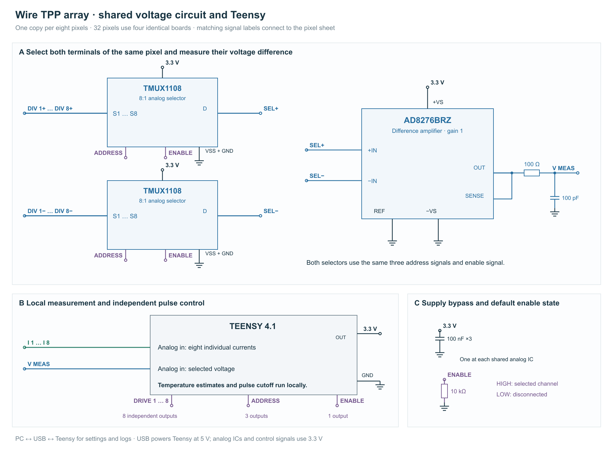
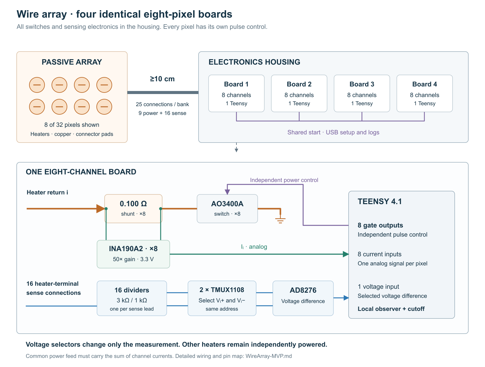

# Wire TPP array — circuit and temperature control

- Build **32 channels as four identical eight-pixel boards**, each controlled by one Teensy 4.1.
- Give every heater an independent switch and current sensor; share voltage measurement across each board.
- Keep the tactile array passive, with the electronics **at least 10 cm away** and separate voltage-sense connections at the heater pads.
- Use one batch resistance–temperature calibration, each pixel's room-temperature resistance, and local pulse deadlines.

## 1. Circuit

**Goal:** measure each heater's electrical resistance while controlling its heating pulses independently.




*Electrical schematic in two sheets; component placement and PCB routing are separate layout steps.*

Each channel uses an **AO3400A**, **0.100 Ω shunt** and **INA190A2**. Two selectors and one **AD8276** measure the voltage across the selected heater. The other heaters continue operating during selection. Separate sense connections exclude power-cable and contact voltage drops from heater-voltage measurement.

At **0.47 A through the shunt**, the current amplifier outputs **2.35 V** and the shunt dissipates **22 mW**. Set the initial heater-current ceiling to **0.55 A**, including current that bypasses the shunt through the voltage-sensing network.

## 2. Power and local control

**Goal:** supply concurrent pixels and stop each pulse from its local temperature estimate.

A **12.5 Ω heater at 2.8 W** draws approximately **0.47 A at 5.9 V**. Eight simultaneous heaters draw about **3.8 A**; 32 require about **15 A and 90 W instantaneous heater power**. At 20% duty, mean heater power is approximately **18 W**. Set the rail above the required heater voltage by the measured cable, shunt and switch drops, within the circuit's voltage range. Size the supply for concurrent loads or limit simultaneous heating.

The PC loads calibration and run settings, then collects logs. Each Teensy scans its eight channels and enforces pulse deadlines locally. A wired start signal can coordinate boards. Measure the complete delay from sampling through computation to switch turn-off and include it in the deadline calculation.

The thermal model tracks heater temperature $T$ and surrounding-material temperature $S$:

$$
C(T)\dot T=P-G(T-S),\qquad
\dot S=\beta(T-S)-\gamma(S-T_a).
$$

Here $P$ is heater power, $C$ its heat capacity, $T_a$ ambient temperature, and $G,\beta,\gamma$ fitted heat-transfer coefficients. Retain both states between pulses. Resistance measurements narrow predicted temperature ranges using the batch calibration; retain all compatible branches when the curve is nonmonotonic. Set the next cutoff from the highest remaining heater or surrounding temperature, the minimum heat capacity and maximum possible heater power.

## 3. Measurement and calibration

**Goal:** obtain heater resistance with explicit electrical uncertainty.

Calibrate each current path at two positive currents, measuring the reference current in the **shunt/MOSFET branch**, and check an intermediate value. Fit $I_s=a_I n_I+c_I$, where $n_I$ is the ADC reading. Calibrate the complete voltage path similarly as $V_h=a_V n_V+c_V$, including dividers, selectors and AD8276 loading. Check error over the installed common-mode voltage and concurrent-load range.

Heater current includes sensing-network current that bypasses the shunt:

$$
I_h\in[I_s^-+b^-,\ I_s^++b^+],\qquad
R_h\in\left[\frac{V_h^-}{I_h^+},\frac{V_h^+}{I_h^-}\right],\quad I_h^->0.
$$

The interval $[b^-,b^+]$ bounds this additional, signed current. With only the 3 kΩ/1 kΩ return divider connected, it is approximately $V_-/4000$, where $V_-$ is the heater's negative-terminal voltage. The selected AD8276 path adds loading. During the resistor-load checkout, compare a reference measurement in the **heater lead, before the sensing branch**, with calibrated shunt current; retain a range covering selector states, concurrent loads, circuit warming and reference-meter error. Include residual settling error in the voltage and current intervals.

Use settled ON readings for resistance. During switching and OFF periods, propagate the thermal states with the corresponding power bounds. Preserve sample timestamps; stop heating on stale data, a missed acquisition deadline, or disagreement between settled measurements and the calibrated electrical range.

## Appendix A — bill of materials

### Per-pixel parts

| Item | Selected part/configuration |
|---|---|
| Current amplifier | **INA190A2DCKR**, SC70-6, gain 50, 3.3 V, REF grounded |
| Shunt | **Vishay WSLP0805R1000FEA**, 0.100 Ω, 1%, 0.5 W; calibrate installed value |
| Heater MOSFET | **AO3400A** |
| Gate components | **1 kΩ** series; **100 kΩ** gate-to-source |
| Voltage scaling | Two **3.00 kΩ/1.00 kΩ** divider pairs, 0.1%, preferably ≤25 ppm/K; heater rail below 10 V |
| Filtering | **1 nF** per divider midpoint; current output **100 Ω/1 nF** |
| Supply bypass | **100 nF** at the current amplifier |

### Complete system

| Part/function | Eight-pixel board | 32-pixel system |
|---|---:|---:|
| Teensy 4.1 | 1 | 4 |
| INA190A2DCKR | 8 | 32 |
| 0.100 Ω WSLP0805 shunt | 8 | 32 |
| AO3400A + gate resistor + pull-down | 8 sets | 32 sets |
| TMUX1108PWR | 2 | 8 |
| AD8276BRZ | 1 | 4 |
| 3.00 kΩ/1.00 kΩ divider pairs | 16 pairs | 64 pairs |
| Divider 1 nF capacitors | 16 | 64 |
| Current-output 100 Ω/1 nF filters | 8 | 32 |
| Voltage-output 100 Ω/100 pF filter | 1 | 4 |
| Analog-IC 100 nF bypass capacitors | 11 | 44 |
| Selector-enable 10 kΩ pull-down | 1 | 4 |

Provide supply protection, a physical supply disconnect, USB connections and power connectors rated for concurrent loads. Join Teensy ground to supply negative; route heater current separately from measurement ground. Keep analog circuits powered whenever the heater rail is enabled. Size bulk capacitance from measured pulse-induced rail droop.

## Appendix B — connections and pin map

### One channel, repeated eight times

```text
Common supply+ → power lead → heater i → individual return → 0.100 Ω → AO3400A drain
                                                                        source → ground
                                             INA190 IN+ ─┘       └─ IN−
                                             INA190 OUT → Teensy current input i

Heater i sense+ → terminal divider → positive-voltage selector input i
Heater i sense− → terminal divider → negative-voltage selector input i
Selected terminal pair → shared AD8276 difference amplifier → Teensy voltage input
```

Place the shunt between the heater return and MOSFET drain. Route separate traces from its pads to INA190 IN+ and IN−. DCK pins are **1 REF, 2 GND, 3 VS, 4 IN+, 5 IN−, 6 OUT**. The amplifier operates continuously. Its ±15 µV maximum offset corresponds to ±0.15 mA before calibration.

Both **TMUX1108PWR** selectors use 3.3 V, shared address/enable lines, and VSS and GND connected to common ground. **Enable HIGH connects; LOW disconnects.** Add the 10 kΩ enable pull-down.

Connect the selected positive divider to **AD8276BRZ pin 3**, negative to **pin 2**; **pin 7** to 3.3 V, **pin 4 and REF pin 1** to ground, **SENSE pin 5** to **OUT pin 6**. OUT feeds **100 Ω with 100 pF at the ADC**. Check the complete voltage path over **0.20–2.50 V output**, approximately 0.8–10 V heater voltage after calibration, including recovery from zero-output saturation. Use the measured settling time after selection or a switching edge.

| Function | Teensy 4.1 pins |
|---|---|
| Eight current outputs, ADC0 | **14–21** |
| Shared differential-voltage output, ADC1 | **26** |
| Eight heater gates | **2–9** |
| Selector address A0/A1/A2 | **10/11/12** |
| Selector enable | **13** |
| Common start / external stop | Reserve **0/1**, with defined default levels |

Use the Teensy ADC library's synchronized read functions for the current/voltage pair. Measure the residual timing difference and analog-path delays with the installed filters and cables.

## Appendix C — cable layout and fabrication

- **25 functional conductors per eight pixels:** one positive feed, eight returns and sixteen sense connections. Start sense traces at the heater pads.
- Rate the common feed and connector for **4.4 A** at the eight-channel ceiling.
- An **18-conductor version** uses one feed, eight returns, eight negative senses and one shared positive sense. Include measured positive-bus variation under concurrent loads in its voltage uncertainty.
- At a representative 6 V rail, a 4 kΩ return divider produces approximately **30 µW** of off-state heating in a 12.5 Ω heater. Include additional front-end leakage in the OFF-power bound.

1. Fabricate the existing laboratory geometry from its digital CAD. Preserve cavities, wire threading and heater pads; add terminal-sense traces and verify connector orientation. Export manufacturing files through the established laboratory process.
2. Check the shared-bus netlist. An isolated resistive bus can serve as the positive feed; remove any conflicting ground connection before use.
3. Build one eight-channel electronics board with supply, current, voltage and gate test points. Separate power and measurement routing and keep shunts/amplifiers away from switch heating.
4. Check eight stable resistor loads using the final cables and selector sequence. Record electrical errors, bypass-current bounds, neighboring-channel effects and total cutoff delay under concurrent loads.
5. Obtain one same-batch resistance–temperature curve; measure each pixel's room-temperature resistance and check representative assembled pixels for baseline changes. Load channel calibration, curve identity and pulse limits into the common firmware, then duplicate the board.

## Appendix D — measurement procedure

```pseudocode
At startup:
    Set all heater gates LOW and selector enable LOW.
    Load channel calibration, uncertainty and room-temperature resistance.
    Initialize thermal states from ambient only after the established cooling time.
Before each heating pulse:
    Program a local switch-off deadline using the current temperature ranges.
    Enable the requested heater only while that deadline remains valid.
For each selected channel i:
    Set selector address i and enable; wait the measured settling time.
    Start startSynchronizedSingleRead(14+i, 26) and record acquisition times.
    If conversion exceeds its timeout, switch off, record the fault and end this acquisition.
    Read the pair with readSynchronizedSingle().
    If its timestamp is no later than stored state time, switch off and discard this acquisition.
    Advance both thermal states to the sample time using elapsed ON, edge and OFF intervals.
    If the heater is OFF or still settling, skip the resistance update.
    Otherwise:
        Convert readings to calibrated shunt-current and heater-voltage intervals.
        Add the bypass-current interval to obtain heater current.
        Divide voltage by positive heater current, then normalize by room-temperature resistance.
        Keep temperature cells compatible with both prediction and resistance.
        Switch off if no state remains or prediction leaves the calibrated range.
    Update the local deadline; retain thermal states after switch-off.
    Log timestamps, raw readings, corrected current/voltage and temperature ranges.
After a fault:
    Disable further pulses until its cause is resolved and the initial thermal state is established.
```

## Appendix E — system diagram


